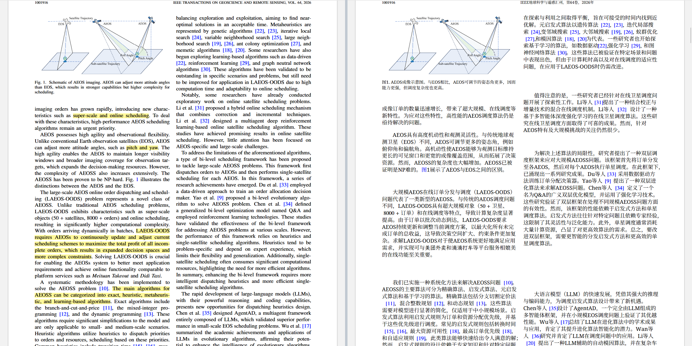

# Transfer Plus — Bilingual PDF Reading for Zotero

[简体中文](README.md) | **English**

With a single click of "Translate" in Zotero, Transfer Plus produces a complete bilingual companion PDF that preserves the original layout and mathematical formulas: your paper is **never uploaded to any cloud parsing service** — BabelDOC 0.7.1 performs layout and typesetting locally, and only the text to be translated is sent to the LLM API you configure.

## Demo



The left pane shows the original paper; the right pane is the Chinese companion PDF generated by the plugin — layout, columns and mathematical formulas (superscripts, integrals, matrices, …) are all preserved as-is, ready for synchronized reading and annotation.

## Features

- **One-click translation**: a single "Translate" button performs the local archive check, gap detection, translation, full-PDF typesetting and in-place attachment update; repeated clicks automatically reuse existing translations and only fill the gaps.
- **Papers never leave your machine**: BabelDOC 0.7.1 + onnxruntime parse and typeset locally — no queueing, no cloud OCR; only the text to translate is sent to the API you configure.
- **Math objects preserved as-is**: vector instructions and formula fonts are verified item by item; formulas are never re-drawn from guessed LaTeX; unsafe regions fall back to the original text and are clearly reported.
- **In-place attachment update**: translations are written into the same Chinese attachment — atomic replacement that keeps the attachment ID and annotations; a backup is taken before every update.
- **Resumable jobs & caching**: jobs can be cancelled and resumed; re-running with unchanged rules makes zero model requests. Measured locally on a 15-page paper: ~2.4 minutes cold start for full delivery, 0.14-second cache hit on the second click.
- **Quota & rate-limit protection**: field-proven rate limiting, quota circuit breaker, `{{N}}` placeholder validation and cancellation semantics; the plugin pauses when quota is exhausted and never silently switches to paid plans.
- **Vendor-neutral translation backend**: standard OpenAI-compatible protocol — any model that follows instructions reliably works (GPT, Claude, Kimi, GLM, DeepSeek, Qwen, etc.); the base URL and model are fully configurable, including third-party or self-hosted endpoints.
- **Credential safety**: API keys are stored encrypted with Windows DPAPI, bound to the current Windows account; the source code, packages and logs contain no credentials.

## Requirements

| Dependency | Requirement |
|---|---|
| OS | Windows 10/11 (64-bit; the runtime ships an isolated Python and does not touch your system environment) |
| Zotero | 10.x |
| Translation API | An API key for any OpenAI-compatible LLM API (GPT, Claude, Kimi, GLM, DeepSeek, Qwen, etc. — the exact model is your choice; API base URL and model are freely configurable) |

## Installation (3 steps)

1. **Install the local service**: download `research-max-bilingual-runtime-0.4.0-win64.zip` from [Releases](../../releases), extract it to any temporary folder and run inside it:

   ```powershell
   powershell -ExecutionPolicy Bypass -File install-runtime.ps1
   ```

   The script verifies the SHA256 of every file before installing (default location `D:\ZoteroTools\research-max-bilingual`, or `%LOCALAPPDATA%` if there is no D: drive; customize with `-RuntimeRoot <path>`).

2. **Install the plugin**: download `research-max-bilingual-0.4.0.xpi`, then in Zotero choose **Tools → Plugins → gear icon (top right) → Install Plugin From File** and select the file.

3. **Configure the translation API**: open **Tools → 中文对照设置 (Bilingual Settings)**, choose "Custom (any OpenAI-compatible service)" and fill in the **API base URL** and **model** fields, or use a built-in preset as a shortcut, then paste your API key and click **Save**; use "Test connection" to verify. Any mainstream family works — GPT, Claude, Kimi, GLM, DeepSeek, Qwen, etc. — and the exact model is up to you, as long as it follows instructions reliably (strictly preserving the `{{N}}` math placeholders); a text-only model is sufficient.

> Since 0.4.0, **no OCR cloud token is required** and paper files are never uploaded.

## Everyday use

- Open an item's PDF and click **Translate** in the toolbar. The button shows its working state; you can click **Cancel** mid-run — cancelling keeps the progress, and clicking again resumes.
- Translations are written directly into the Chinese PDF, which reads **side by side** with the original — synchronized or independent scrolling; the toolbar shows the written-text ratio.
- The **Needs review** menu lists unfinished or preserved regions and locates them on click — nothing is silently hidden.
- Identity information in references (authors, journal names, DOIs) stays in the original language, while recognizable titles are translated.
- Uninstalling the plugin stops the local service; all imported translations, annotations and local archives are kept.

## Privacy

- PDFs are parsed and typeset on this machine only; the only outbound traffic is the text segments to be translated, sent to the translation API you configured.
- API keys are encrypted with Windows DPAPI and bound to the current Windows account.
- Local caches (layout inventories, paragraph translations, final PDFs, quality reports) live under `data/` in the runtime directory and can be deleted manually at any time; logs contain no credentials or paper content.

## Open-source projects used

This project derives from and combines the following open-source projects (all upstreams are AGPL-3.0, which is why this repository as a whole is published under AGPL-3.0-or-later):

| Project | Pinned version | Role | License |
|---|---|---|---|
| [BabelDOC](https://github.com/funstory-ai/BabelDOC) | 0.7.1 | Local PDF parsing & layout engine (the 0.4.0 kernel), with the [engine-patches](engine-patches/README.md) adaptation | AGPL-3.0 |
| [Z-Transplit](https://github.com/Liozhang/z-transplit) | 1.20.0 | Reader split-pane and synchronized reading (adapted for annotations) | AGPL-3.0 |
| [Zotero PDF2zh](https://github.com/guaguastandup/zotero-pdf2zh) | 4.1.8 | Task management framework | AGPL-3.0 |
| [PDFMathTranslate Next](https://github.com/PDFMathTranslate-next/PDFMathTranslate-next) | 2.10.2 | Legacy dependency (removed since 0.3; license notice retained) | AGPL-3.0 |
| [Source Han Serif](https://github.com/adobe-fonts/source-han-serif) | — | CJK font | SIL OFL 1.1 |
| [Noto Serif](https://github.com/notofonts/noto-fonts) | — | Latin fallback font | SIL OFL 1.1 |

The runtime package additionally bundles PyMuPDF, Flask, the OpenAI client, Requests, Pillow, FileLock and other dependencies; the full inventory (versions and licenses) ships as `dependency-inventory.json` inside the runtime package along with each `dist-info`. License texts are collected in [licenses/](licenses/README.md).

## Known limitations

- Scanned PDFs (no text layer) **fail fast with a clear message** — no unreliable guess translation.
- Math protection is based on item-by-item verification (glyphs, fonts, positions, sizes, object aspect ratios); it only catches the errors it explicitly covers and cannot prove every PDF correct; unsafe regions fall back to the original text.
- The coverage ratio is the share of translated text written into the PDF — not translation accuracy or recognition recall.
- The runtime package currently supports 64-bit Windows only.

## License

[AGPL-3.0-or-later](LICENSE). This repository contains modifications and adaptations of several AGPL-3.0 upstream projects and is therefore distributed as a whole under AGPL-3.0 as their licenses require; reused files retain their original authors' notices.

## Development

```powershell
npm ci          # install build dependencies (Node.js)
npm test        # plugin tests (Node)
npm run build   # build the XPI into dist/
python -m unittest discover -s tests -p 'test_*.py'   # local service tests (Python 3.12)
```

- `scripts/build_runtime.py`: builds the isolated runtime from a given Python 3.12 and font directory (dependencies locked in `server/requirements.lock`).
- `scripts/package_release.py --runtime <runtime dir>`: produces the XPI-matching runtime package, source archive, dependency inventory and SHA256 checksums; it refuses to package data, keys or papers.
- See [engine-patches/README.md](engine-patches/README.md) for engine adaptation notes and [docs/CHANGELOG.md](docs/CHANGELOG.md) for the version history.

v0.4.0 is the first public release.
