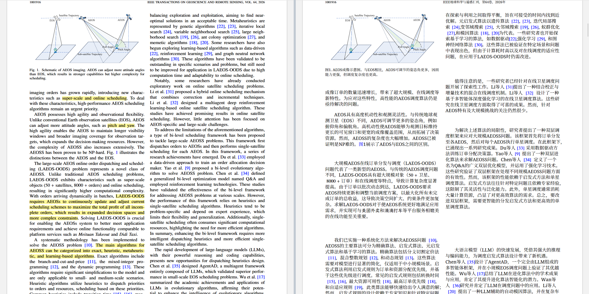

# Transfer Plus — Zotero 论文中文对照阅读

**简体中文** | [English](README.en.md)

在 Zotero 里单击一次"翻译"，即可得到整份保留版式与数学公式的中文对照 PDF：论文**不再上传任何云端解析服务**，BabelDOC 0.7.1 在本机完成布局与排版，仅待译文本发送至你自己配置的大模型接口。

## 演示



左侧为论文原文，右侧为插件生成的中文对照 PDF——版式、分栏与数学公式（含上标、积分、矩阵等）均原样保留，可直接同步阅读与批注。

## 特性

- **一键翻译**：单个"翻译"按钮完成本机存档检查、缺漏识别、翻译、整份 PDF 排版与原附件更新；已有译文时按钮变为"打开/关闭对照"，查漏补缺与重译经右键菜单"更新译文"显式触发，复用已译内容、只补缺漏。
- **原位对照阅读**：翻译完成后同一阅读界面自动变为原文/译文左右对照，重启 Zotero 自动恢复；可一键关闭恢复原文单栏、再一键从本机存档秒开，译文与批注全程保留。
- **论文不出本机**：BabelDOC 0.7.1 + onnxruntime 本地解析与排版，零排队、无云端 OCR；只有待译文本发送到你配置的翻译接口。
- **数学对象原样保留**：矢量指令与公式字体逐项核验后保留，不猜测 LaTeX 重画公式；不安全的局部回退保留原文并明确报告。
- **原位附件更新**：译文写入同一中文附件，原子替换、保留附件 ID 与批注；更新前自动备份。
- **断点续传与缓存**：任务可恢复、可取消；相同规则重跑零模型请求。本机实测（15 页论文）：冷启动约 2.4 分钟完整交付，二次点击 0.14 秒缓存命中。
- **额度与限速保护**：沿用经过实测的限速、配额熔断、`{{N}}` 占位符校验与取消语义；额度耗尽自动暂停，不静默切换付费方案。
- **翻译后端不锁定厂商**：标准 OpenAI 兼容协议，任意能稳定遵循指令的大模型均可使用（GPT、Claude、Kimi、GLM、DeepSeek、Qwen 等），接口地址与模型完全自定义，第三方或本地部署的兼容服务同样支持。
- **凭据安全**：API Key 使用 Windows DPAPI 加密存储，仅适用当前 Windows 账户；源码、安装包与日志不含任何凭据。

## 系统要求

| 依赖 | 要求 |
|---|---|
| 操作系统 | Windows 10/11（64 位，运行包自带独立 Python，不污染系统环境） |
| Zotero | 10.x |
| 翻译接口 | 任意 OpenAI 兼容大模型 API 的密钥（GPT、Claude、Kimi、GLM、DeepSeek、Qwen 等均可，具体型号由你自选；API 地址与模型完全自定义） |

## 安装（三步）

1. **安装本机服务**：从 [Releases](../../releases) 下载 `research-max-bilingual-runtime-0.4.0-win64.zip`，解压到任意临时目录，在其中运行：

   ```powershell
   powershell -ExecutionPolicy Bypass -File install-runtime.ps1
   ```

   脚本会校验每个文件的 SHA256 再安装（默认装到 `D:\ZoteroTools\research-max-bilingual`，无 D 盘时装到 `%LOCALAPPDATA%`；可用 `-RuntimeRoot <路径>` 自定义）。

2. **安装插件**：下载 `research-max-bilingual-0.4.2.xpi`，在 Zotero 中 **工具 → 插件 → 右上角齿轮 → 从文件安装插件**，选择该文件。

3. **填写翻译接口**：打开 **工具 → 中文对照设置**，选择"自定义（任意 OpenAI 兼容服务）"并填写 **翻译标准 API 地址** 与 **翻译模型**，或用内置预设快捷填充，粘贴 API Key，点击 **保存**，可用"检测连接"验证。GPT、Claude、Kimi、GLM、DeepSeek、Qwen 等主流模型均可，具体型号由你自行选择；模型只需能稳定遵循指令（严格保留 `{{N}}` 数学占位符）即可，文本模型即可胜任。

> 0.4.0 起**不再需要**任何 OCR 云服务令牌，论文文件不会上传。

## 日常使用

- 打开条目的 PDF，点击工具栏 **翻译**。按钮进入工作状态，期间可点击 **取消翻译**；取消保留进度，再次点击继续。
- 翻译完成后同一阅读界面变为**左右对照**（原文在左、译文在右）；重启 Zotero 后自动恢复对照状态。完成后按钮变为 **关闭对照**，点击恢复原文单栏（译文与批注保留），再点 **打开对照** 从本机存档即时打开。
- 译文以"中文对照"子附件保存在条目下（可独立批注、随文库同步）；更换翻译设置后重译时，被取代的旧对照附件自动移入回收站，带批注的会保留并提示。
- 译文直接写入中文 PDF，与原文**左右对照**阅读，可同步滚动或独立阅读；工具栏分别显示原生文字写入比例。
- **待核对**菜单列出未完成或保留原文的区域，点击定位，不静默隐藏问题。
- 参考文献中的作者、刊名、DOI 等身份信息保留原文，可识别的题名正常翻译。
- 卸载插件会停止本机服务，已导入的译文、批注与本机存档全部保留。

## 隐私

- 论文 PDF 只在本机解析、排版；出网内容仅限待译文本段落，发送至你在设置中配置的翻译接口。
- API Key 以 Windows DPAPI 加密保存，绑定当前 Windows 账户。
- 本机缓存（识别清单、段落译文、最终 PDF、质量报告）保存在运行目录 `data/` 下，可随时手工删除；日志不含凭据与论文内容。

## 引用的开源项目

本项目是以下优秀开源项目的衍生与组合（上游均为 AGPL-3.0，因此本仓库整体以 AGPL-3.0-or-later 发布）：

| 项目 | 固定版本 | 用途 | 许可 |
|---|---|---|---|
| [BabelDOC](https://github.com/funstory-ai/BabelDOC) | 0.7.1 | 本地 PDF 解析与排版引擎（0.4.0 内核），含 [engine-patches](engine-patches/README.md) 适配 | AGPL-3.0 |
| [Z-Transplit](https://github.com/Liozhang/z-transplit) | 1.20.0 | 阅读器分屏与同步阅读（已适配批注） | AGPL-3.0 |
| [Zotero PDF2zh](https://github.com/guaguastandup/zotero-pdf2zh) | 4.1.8 | 任务管理框架 | AGPL-3.0 |
| [PDFMathTranslate Next](https://github.com/PDFMathTranslate-next/PDFMathTranslate-next) | 2.10.2 | 历史版本依赖（0.3 起已移除，保留许可声明） | AGPL-3.0 |
| [Source Han Serif 思源宋体](https://github.com/adobe-fonts/source-han-serif) | — | 中文字体 | SIL OFL 1.1 |
| [Noto Serif](https://github.com/notofonts/noto-fonts) | — | 拉丁字母后备字体 | SIL OFL 1.1 |

运行包同时捆绑 PyMuPDF、Flask、OpenAI 客户端、Requests、Pillow、FileLock 等依赖，完整清单（含版本与许可证）见运行包内 `dependency-inventory.json` 与各 `dist-info`。各许可原文见 [licenses/](licenses/README.md)。

## 已知边界

- 扫描版 PDF（无文字层）会**快速失败并明确提示**，不做不可靠的猜测性翻译。
- 复杂公式的保护基于逐项核验（字形、字体、位置、字号、对象宽高）；只能发现明确覆盖的错误，不能证明任意 PDF 全部正确，不安全局部回退保留原文。
- 覆盖比例是"译文写入 PDF 的比例"，不是翻译准确率或识别召回率。
- 目前运行包仅支持 Windows 64 位。

## 许可

[AGPL-3.0-or-later](LICENSE)。本仓库包含对多个 AGPL-3.0 上游项目的修改与适配，按其许可要求整体以 AGPL-3.0 发布；复用的文件保留原作者声明。

## 开发

```powershell
npm ci          # 安装构建依赖（Node.js）
npm test        # 插件测试（Node）
npm run build   # 构建 XPI 至 dist/
python -m unittest discover -s tests -p 'test_*.py'   # 本机服务测试（Python 3.12）
```

- `scripts/build_runtime.py`：从指定 Python 3.12 与字体目录构建独立运行环境（依赖锁定见 `server/requirements.lock`）。
- `scripts/package_release.py --runtime <运行目录>`：生成 XPI 配套运行包、源码包、依赖清单与 SHA256；禁止打包数据、密钥与论文。
- 引擎适配说明见 [engine-patches/README.md](engine-patches/README.md)，版本历史见 [docs/CHANGELOG.md](docs/CHANGELOG.md)。

v0.4.0 是首个公开发布版本。
